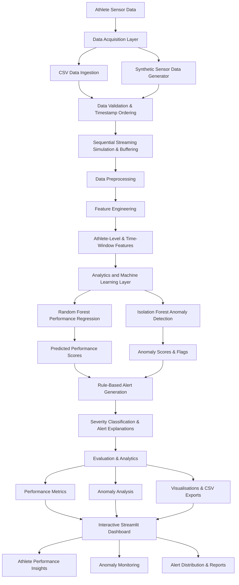
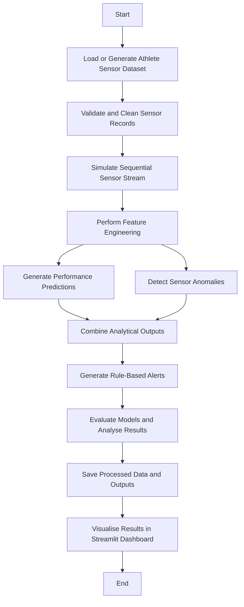

# Real-Time Sports Analytics

## Real-Time Athlete Performance Analytics and Anomaly Detection

An end-to-end **Real-Time Athlete Performance Analytics System** that combines sensor-data processing, machine learning, anomaly detection, and rule-based alert generation to analyse athlete activity and identify unusual performance patterns. he project demonstrates a complete analytics workflow, including sensor-data ingestion, sequential streaming simulation, preprocessing, feature engineering, Random Forest-based performance-score estimation, Isolation Forest anomaly detection, and interactive dashboard visualisation using Streamlit.

> **Data Disclaimer:** This project includes a reproducible synthetic athlete sensor-data generator for educational and demonstration purposes. Synthetic records do not represent actual athlete measurements, medical observations, or validated sports-science findings. Real-world use requires authorised, consented sensor data and independent validation.

---

## Project Objectives

- Develop an end-to-end athlete sensor analytics pipeline.
- Demonstrate batch processing and sequential streaming simulation.
- Transform raw sensor measurements into meaningful analytical features.
- Estimate athlete performance scores using supervised machine learning.
- Identify unusual sensor patterns using unsupervised anomaly detection.
- Generate interpretable alerts using configurable rule-based conditions.
- Evaluate analytical models using appropriate performance metrics.
- Present athlete-level insights through an interactive dashboard.

## Key Features

- **Sensor Data Ingestion:** Loads athlete sensor records from CSV files or a simulated data stream.
- **Data Validation:** Checks missing values, data types, timestamps, and sensor measurements.
- **Sequential Streaming Simulation:** Processes sensor records in timestamp order using a simulated streaming workflow.
- **Feature Engineering:** Extracts acceleration magnitude, rolling heart-rate statistics, speed changes, acceleration changes, and exertion-related features.
- **Performance Prediction:** Uses Random Forest regression to estimate a defined performance-score target.
- **Anomaly Detection:** Applies Isolation Forest to identify unusual sensor patterns.
- **Rule-Based Alert Generation:** Produces configurable alerts with severity levels and explanatory messages.
- **Athlete-Level Analytics:** Supports athlete-wise summaries and time-window analysis.
- **Model Evaluation:** Calculates regression metrics and classification-style anomaly metrics when ground-truth labels are available.
- **Interactive Dashboard:** Visualises sensor trends, predicted performance, anomaly events, and generated alerts.
- **Exportable Results:** Saves processed datasets, predictions, anomaly records, and analytical outputs.

---

## System Architecture

The system follows a modular architecture that transforms raw athlete sensor measurements into performance estimates, anomaly indicators, and actionable analytical information.

The architecture consists of six major layers:

1. Sensor Data Acquisition
2. Data Preprocessing and Streaming Simulation
3. Feature Engineering
4. Predictive Analytics and Anomaly Detection
5. Alert Generation and Evaluation
6. Dashboard Visualisation and Output Management

### 1. Overall System Architecture



### 2. Architecture Components

| Architecture Layer | Components | Responsibility |
|---|---|---|
| Data Acquisition | CSV loader, synthetic data generator | Collects or generates athlete sensor observations. |
| Data Validation | Schema checks, timestamp validation | Ensures incoming sensor records are correctly structured. |
| Streaming Simulation | Sequential processing, buffering | Simulates the arrival and processing of sensor observations over time. |
| Data Preprocessing | Missing-value handling, cleaning, ordering | Prepares sensor measurements for analytical processing. |
| Feature Engineering | Acceleration magnitude, rolling HR, sensor changes | Extracts meaningful features from raw sensor signals. |
| Predictive Analytics | Random Forest Regressor | Estimates athlete performance scores. |
| Anomaly Detection | Isolation Forest | Identifies unusual sensor-feature combinations. |
| Alert Engine | Configurable rules, severity levels | Converts selected conditions into understandable alerts. |
| Evaluation | MAE, RMSE, R², anomaly metrics | Measures model performance and examines flagged observations. |
| Presentation | Streamlit dashboard, charts, reports | Communicates performance insights and anomaly information. |

### 3. Detailed Data Processing Architecture

**Stage 1 — Sensor Data Acquisition**

The system accepts athlete measurements through:

- CSV-based sensor datasets.
- Synthetic sensor-data generation.
- Simulated sequential sensor observations.

Typical sensor inputs include heart rate, speed, and three-axis acceleration measurements.

**Stage 2 — Data Validation and Preprocessing**

Incoming records are checked and prepared before analysis.

Processing operations include:

- Column and schema validation.
- Timestamp conversion and chronological ordering.
- Missing-value identification and handling.
- Duplicate record checks.
- Numerical data validation.
- Athlete identification checks.
- Preparation of consistent sensor measurements.

**Stage 3 — Sequential Streaming Simulation**

The system simulates a continuous stream by processing records in timestamp order.

The simulated workflow can include:

- Reading sensor records sequentially.
- Maintaining a processing buffer.
- Applying preprocessing to incoming observations.
- Updating engineered features.
- Passing prepared observations into analytical models.

This is a software-based streaming simulation, not a deployed live wearable-device or production streaming infrastructure.

**Stage 4 — Feature Engineering**

Raw sensor values are transformed into features that represent athlete movement and activity patterns.

| Engineered Feature | Description |
|---|---|
| Acceleration Magnitude | Combines acceleration across three axes. |
| Rolling Heart-Rate Mean | Calculates average heart rate over a selected time window. |
| Rolling Heart-Rate Standard Deviation | Measures short-term heart-rate variation. |
| Speed Change | Measures the difference between consecutive speed observations. |
| Acceleration Change | Measures changes in acceleration magnitude. |
| Normalised Sensor Features | Scales selected sensor measurements for modelling. |
| Exertion Index | Combines selected sensor features into a constructed exertion indicator. |
| Performance Score | Defined target used for supervised performance-score estimation. |

Acceleration magnitude:

\[
a_{mag}=\sqrt{a_x^2+a_y^2+a_z^2}
\]

Speed change:

\[
\Delta v_t=v_t-v_{t-1}
\]

Acceleration change:

\[
\Delta a_t=a_{mag,t}-a_{mag,t-1}
\]

Rolling heart-rate mean:

\[
HR_{mean,t}=\frac{1}{w}\sum_{i=0}^{w-1}HR_{t-i}
\]

Where \(w\) represents the selected rolling window size.

Feature calculations must respect chronological order. Rolling windows and lag features should not use future observations.

**Stage 5 — Predictive Performance Analytics**

The system uses a Random Forest Regressor to estimate a defined athlete performance-score target.

Input features can include:

- Heart rate
- Speed
- Acceleration magnitude
- Rolling heart-rate statistics
- Speed changes
- Acceleration changes
- Other engineered sensor features

Output:

- Predicted performance score
- Athlete-level prediction summaries
- Prediction trends over time

The performance score is a constructed analytical target in the demonstration. It should not be interpreted as a validated measurement of athletic ability.

**Stage 6 — Anomaly Detection**

Isolation Forest is applied to selected sensor features to identify unusual combinations of measurements.

The algorithm separates observations that are relatively easy to isolate from the broader data distribution.

Outputs include:

- Anomaly indicator
- Anomaly score, where exposed by the implementation
- Flagged sensor observations
- Athlete-wise anomaly summaries
- Time-based anomaly distribution

An anomaly represents a statistically unusual observation. It does not establish injury, fatigue, illness, or a medical condition.

**Stage 7 — Rule-Based Alert Generation**

The alert engine combines configurable sensor thresholds and anomaly flags to generate understandable monitoring messages.

Possible alert categories include:

- Elevated heart-rate threshold
- Unusual speed variation
- Sudden acceleration change
- Unusual sensor-pattern detection
- Multiple-condition alert

Each generated alert can include:

- Athlete identifier
- Timestamp
- Alert category
- Severity level
- Triggering condition
- Explanatory message

Thresholds must be documented and reviewed by qualified sports-science professionals. Alerts are demonstrations of analytical rules, not medical recommendations.

**Stage 8 — Evaluation and Output Management**

The system evaluates predictive results and organises analytical outputs.

Possible outputs include:

- Actual and predicted performance scores
- Regression evaluation metrics
- Flagged anomaly records
- Alert summaries
- Sensor trend visualisations
- Processed datasets
- Exportable CSV reports

**Stage 9 — Interactive Dashboard**

The Streamlit dashboard provides a central interface for exploring athlete performance and sensor analytics.

Dashboard sections may include:

- Overall analytics overview
- Athlete-wise performance summaries
- Real-time-style sensor trend visualisations
- Predicted performance scores
- Anomaly detection results
- Generated alert records
- Alert severity distribution
- Downloadable analytical outputs

### 4. System Workflow



---

## Project Workflow

The implementation follows this sequence:

1. Import required Python libraries.
2. Generate or load the athlete sensor dataset.
3. Perform data understanding and exploratory analysis.
4. Simulate sequential sensor data processing.
5. Apply data cleaning and preprocessing.
6. Perform sensor-based feature engineering.
7. Conduct descriptive analytics.
8. Train and evaluate the performance prediction model.
9. Implement Isolation Forest anomaly detection.
10. Generate rule-based alerts.
11. Evaluate results and create visualisations.
12. Save processed datasets, models, and analytical outputs.
13. Launch the Streamlit dashboard.

## Input Dataset

The project supports a structured athlete sensor dataset.

### Input Schema

| Column | Description |
|---|---|
| `timestamp` | Date and time of sensor observation |
| `athlete_id` | Unique athlete identifier |
| `heart_rate` | Recorded heart rate |
| `speed` | Recorded movement speed |
| `acceleration_x` | Acceleration along the X-axis |
| `acceleration_y` | Acceleration along the Y-axis |
| `acceleration_z` | Acceleration along the Z-axis |
| `performance_score` | Optional supervised training target, typically defined on a 0–100 scale |

### Data Considerations

For real sensor datasets, document:

- Device manufacturer and sensor type.
- Sampling frequency and timestamp precision.
- Measurement units and calibration procedures.
- Missing observations and signal quality.
- Athlete consent and data permissions.
- Data collection conditions and provenance.
- Performance-score definition and validation methodology.

The optional performance score must be available as a legitimate training target. If it is constructed from sensor measurements, document the calculation and avoid presenting the resulting predictions as independent validation of athlete performance.

## Machine Learning Methodology

### 1. Performance Score Estimation

<badge color="success">Supervised Learning</badge>

**Algorithm:** Random Forest Regressor

Random Forest regression combines predictions from multiple decision trees to estimate a continuous performance-score target.

**Workflow:**

1. Select relevant engineered sensor features.
2. Separate the target variable from input features.
3. Split observations into training and testing sets.
4. Train the Random Forest regression model.
5. Generate predictions on held-out observations.
6. Evaluate predictive performance.

**Output:** Estimated athlete performance score.

### 2. Anomaly Detection

<badge color="info">Unsupervised Learning</badge>

**Algorithm:** Isolation Forest

Isolation Forest identifies observations that differ from the learned sensor-data distribution.

**Workflow:**

1. Select relevant sensor and engineered features.
2. Prepare and scale features if required by the implementation.
3. Fit the Isolation Forest model.
4. Calculate anomaly indicators.
5. Extract unusual sensor observations.
6. Analyse the distribution of flagged events.

**Output:** Anomaly indicators and associated sensor observations.

**Important:** Isolation Forest detects unusual statistical patterns. It does not independently determine whether an athlete is injured, fatigued, or at risk.

### 3. Rule-Based Alert Engine

The rule-based alert engine evaluates configurable conditions against sensor observations and anomaly indicators.

Example conceptual rules:

| Condition | Example Alert |
|---|---|
| Heart rate exceeds configured threshold | Elevated heart-rate observation |
| Speed changes beyond configured threshold | Unusual speed variation |
| Acceleration changes beyond configured threshold | Sudden acceleration variation |
| Isolation Forest flags an observation | Unusual sensor pattern detected |
| Multiple configured conditions are triggered | Combined monitoring alert |

These are illustrative rules. Their actual implementation, thresholds, and severity mapping should be documented in the source code.

---

## Evaluation Metrics

### Regression Evaluation

The Random Forest Regressor is evaluated using:

| Metric | Purpose |
|---|---|
| MAE | Measures average absolute prediction error. |
| RMSE | Penalises larger prediction errors more strongly. |
| R² Score | Measures explained variance relative to a baseline. |

Mean Absolute Error:

\[
MAE=\frac{1}{n}\sum_{i=1}^{n}|y_i-\hat{y}_i|
\]

Root Mean Squared Error:

\[
RMSE=\sqrt{\frac{1}{n}\sum_{i=1}^{n}(y_i-\hat{y}_i)^2}
\]

Coefficient of Determination:

\[
R^2=1-\frac{\sum_{i=1}^{n}(y_i-\hat{y}_i)^2}
{\sum_{i=1}^{n}(y_i-\bar{y})^2}
\]

### Anomaly Detection Evaluation

When reliable ground-truth anomaly labels are available, evaluate using:

- Precision
- Recall
- F1-score
- Confusion matrix

When labels are unavailable, report:

- Percentage of observations flagged as anomalous.
- Number of flagged observations.
- Athlete-wise anomaly distribution.
- Time-based anomaly distribution.
- Manual review of selected flagged events.

Anomaly rates alone do not establish detection accuracy. Synthetic anomaly labels must not be presented as real-world validation.

---

## Technology Stack

| Category | Technologies |
|---|---|
| Programming Language | Python |
| Data Processing | Pandas, NumPy |
| Machine Learning | Scikit-learn |
| Regression Model | Random Forest Regressor |
| Anomaly Detection | Isolation Forest |
| Data Visualisation | Matplotlib, Seaborn |
| Dashboard | Streamlit |
| Data Storage | CSV |
| Development Environment | Jupyter Notebook, Google Colab, VS Code |
| Version Control | Git, GitHub |

---

## Repository Structure

```text
Real-Time-Sports-Analytics/
│
├── app.py
├── requirements.txt
├── README.md
├── LICENSE
├── .gitignore
│
├── config/
│   └── settings.yaml
│
├── data/
│   ├── README.md
│   └── generated/
│
├── notebooks/
│   └── 01_Athlete_Performance_Analytics.ipynb
│
├── src/
│   ├── data_generator.py
│   ├── preprocessing.py
│   ├── feature_engineering.py
│   ├── modeling.py
│   ├── anomaly_detection.py
│   ├── alerts.py
│   └── pipeline.py
│
├── models/
│   └── README.md
│
├── results/
│   └── README.md
│
├── screenshots/
│   └── README.md
│
├── docs/
│   ├── methodology.md
│   ├── architecture.md
│   ├── System_Architecture.png
│   ├── Project_Report.pdf
│   └── Methodology.pdf
│
├── presentation/
│   └── project_presentation.pptx
│
└── tests/
    └── test_pipeline.py
```

*This structure describes the intended project organisation. Update it to match the files and directories actually committed to the repository.*

---

## Installation and Setup

### Prerequisites

- Python 3.10 or later
- pip package manager
- Git (optional)

### 1. Clone the Repository

```bash
git clone <repository-url>
cd Real-Time-Sports-Analytics
```

### 2. Create a Virtual Environment

```bash
python -m venv venv
```

**Windows:**

```bash
venv\Scripts\activate
```

**macOS / Linux:**

```bash
source venv/bin/activate
```

### 3. Install Dependencies

```bash
pip install -r requirements.txt
```

### 4. Generate Synthetic Sensor Data

Execute the project's data-generation script or documented notebook workflow to create the demonstration dataset.

```bash
python src/data_generator.py
```

### 5. Run the Analytics Pipeline

```bash
python src/pipeline.py
```

### 6. Launch the Streamlit Dashboard

```bash
streamlit run app.py
```

Open the local URL displayed in the terminal to explore the athlete analytics dashboard.

> **Setup note:** The commands above assume the described scripts expose executable entry points. Adjust them to the actual implementation if your scripts use different function names or execution methods.

---

## Dashboard Visualisation

The dashboard is designed to present the following analytical views:

| Dashboard Section | Visualisation / Information |
|---|---|
| Overview | Athlete count, sensor observations, and key analytics summaries |
| Sensor Monitoring | Heart-rate, speed, and acceleration trends |
| Performance Analytics | Predicted performance-score trends |
| Athlete Analysis | Athlete-wise summaries and comparisons |
| Anomaly Detection | Flagged sensor observations and anomaly distribution |
| Alert Monitoring | Alert categories, severity, and event details |
| Reports | Downloadable processed data and analytical outputs |

---

## Limitations

- The demonstration dataset is synthetic and does not represent actual athlete measurements.
- The simulated streaming workflow does not establish production-grade real-time ingestion.
- Performance scores are constructed targets unless replaced with independently validated outcomes.
- Random Forest predictions depend on the quality and representativeness of training data.
- Isolation Forest may flag valid but uncommon athlete activities as anomalies.
- Anomaly detection does not establish injury, fatigue, or medical risk.
- Rule-based alert thresholds are illustrative unless validated by domain experts.
- Sensor noise, device differences, sampling frequency, and missing measurements can affect analytical reliability.
- Real-world deployment requires independent validation using appropriately collected athlete data.

## Responsible Use and Data Privacy

This project is an educational sports analytics prototype, not a clinical, medical, or athlete-safety decision system.

- Obtain informed consent before collecting or processing real athlete data.
- Use only authorised sensor datasets.
- Protect athlete identifiers and personal information.
- Apply data minimisation and secure storage practices.
- Validate sensor calibration and measurement quality.
- Review model outputs with qualified sports-science professionals.
- Do not use anomaly flags to diagnose injuries or medical conditions.
- Do not make fitness-to-play or training restriction decisions solely from model predictions.
- Validate alert thresholds before considering any operational application.

---

## Future Enhancements

- Integration with authorised wearable sensor devices.
- Real-time sensor ingestion through MQTT or Apache Kafka.
- WebSocket-based live dashboard updates.
- Advanced time-series forecasting.
- Deep learning-based athlete activity analysis.
- LSTM-based sensor sequence modelling.
- Athlete-specific anomaly detection.
- Adaptive alert thresholds.
- Explainable AI for performance predictions.
- Model drift and sensor quality monitoring.
- Cloud-based deployment and scalable data processing.
- Secure athlete data management and access control.

## Conclusion

The Real-Time Sports Analytics project demonstrates how sensor-data engineering, machine learning, anomaly detection, and rule-based alert generation can be combined into a unified athlete performance analytics workflow.

By integrating Random Forest regression, Isolation Forest anomaly detection, sequential streaming simulation, and interactive dashboard visualisation, the system provides an educational framework for analysing sensor patterns and exploring athlete performance indicators.

The project highlights the potential of data-driven sports analytics while recognising the importance of validated outcomes, reliable sensor measurements, privacy protection, and expert oversight before real-world adoption.

---

## Author

**Mohamed Riyaz S.**  
Integrated M.Tech – Computer Science and Engineering (Business Analytics)  
Vellore Institute of Technology (VIT), Chennai
